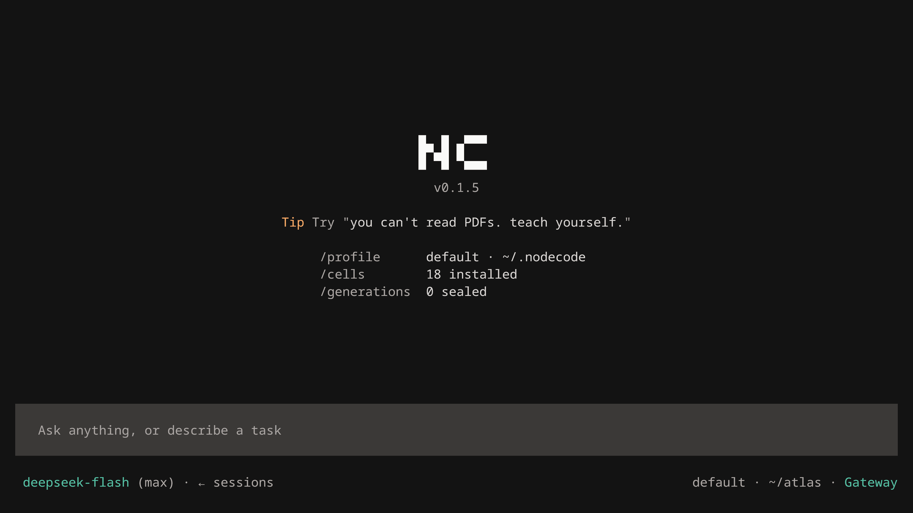

<p align="center">
  <a href="https://nodecode.ai"><picture>
    <source media="(prefers-color-scheme: light)" srcset="resources/assets/readme/banner-light.svg">
    
  </picture></a>
</p>

<p align="center">
  <b>A living agent.</b><br>
  It becomes yours and evolves over time.
</p>

<p align="center">
  <a href="https://nodecode.ai">Website</a> &nbsp;·&nbsp;
  <a href="https://nodecode.ai/docs">Docs</a> &nbsp;·&nbsp;
  <a href="https://nodecode.ai/cells/browse">Cells</a> &nbsp;·&nbsp;
  <a href="https://foresight-labs.eu/research">Research</a> &nbsp;·&nbsp;
  <a href="https://discord.gg/cujGhaGCnS">Discord</a>
</p>

<br>



<p align="center"><sub><i>you can't read PDFs. teach yourself.</i> It defines <code>read-pdf</code>, keeps it, and reads the invoice. A take from the launch trailer: the shell and every evaluation are real, the model's reply is scripted so the take repeats.</sub></p>

Nodecode is an agent that rewrites itself. It runs as one process in SBCL, a Common Lisp system, and shells attach to it. The model has one tool: it evaluates Lisp in the running program and keeps what it defines.

## Install

Linux and macOS:

```sh
curl -fsSL https://nodecode.ai/install.sh | sh
```

Windows, in PowerShell:

```powershell
irm https://nodecode.ai/install.ps1 | iex
```

Then run `nodecode`. The first launch opens setup. If another coding agent lives on the machine (Claude Code, Codex, Hermes Agent, OpenCode, Cursor CLI, Gemini CLI and 9 more), setup names it and asks before it reads anything; say Import and it brings over the agent's keys, instructions, memory, skills, MCP servers, bots and jobs, tick the agents one by one when it found several, or Skip and `/import` brings them over later. Then you pick a provider, a model and the reasoning effort. See [Quickstart](https://nodecode.ai/docs/quickstart) and [First run](https://nodecode.ai/docs/first-run).

## What's different

<picture>
  <source media="(max-width: 479px) and (prefers-color-scheme: light)" srcset="resources/assets/readme/emblem-orchid-light.png 1x">
  <source media="(max-width: 479px)" srcset="resources/assets/readme/emblem-orchid-dark.png 1x">
  <source media="(max-width: 1279px) and (prefers-color-scheme: light)" srcset="resources/assets/readme/emblem-orchid-light-stack.png 2.62x">
  <source media="(max-width: 1279px)" srcset="resources/assets/readme/emblem-orchid-dark-stack.png 2.62x">
  <source media="(prefers-color-scheme: light)" srcset="resources/assets/readme/emblem-orchid-light-side.png 3.67x">
  <source srcset="resources/assets/readme/emblem-orchid-dark-side.png 3.67x">
  
</picture>

### Updates while it runs

An orchid opens new flowers while it keeps growing. An installed Nodecode updates itself the same way: most releases go live in the running program, one changed definition at a time, with no restart. Its own growth is kept as generations: `nodecode generations` lists them, `nodecode rollback N` restores one, and `--pristine` runs the binary alone. [Updates](https://nodecode.ai/docs/updates)

<br clear="left">

<picture>
  <source media="(max-width: 479px) and (prefers-color-scheme: light)" srcset="resources/assets/readme/emblem-dandelion-light.png 1x">
  <source media="(max-width: 479px)" srcset="resources/assets/readme/emblem-dandelion-dark.png 1x">
  <source media="(max-width: 1279px) and (prefers-color-scheme: light)" srcset="resources/assets/readme/emblem-dandelion-light-stack.png 2.62x">
  <source media="(max-width: 1279px)" srcset="resources/assets/readme/emblem-dandelion-dark-stack.png 2.62x">
  <source media="(prefers-color-scheme: light)" srcset="resources/assets/readme/emblem-dandelion-light-side.png 3.67x">
  <source srcset="resources/assets/readme/emblem-dandelion-dark-side.png 3.67x">
  
</picture>

### Everything is a cell

A cell is a folder that teaches Nodecode something new: a chat room it can live in, a provider login, a tool, a skill, a GitHub repo, an MCP server. `nodecode add nc://cline` installs one from the hub and turns it on in every attached shell. Or ask Nodecode to write one. [Cells](https://nodecode.ai/docs/cells)

<br clear="left">

<picture>
  <source media="(max-width: 479px) and (prefers-color-scheme: light)" srcset="resources/assets/readme/emblem-nautilus-light.png 1x">
  <source media="(max-width: 479px)" srcset="resources/assets/readme/emblem-nautilus-dark.png 1x">
  <source media="(max-width: 1279px) and (prefers-color-scheme: light)" srcset="resources/assets/readme/emblem-nautilus-light-stack.png 2.62x">
  <source media="(max-width: 1279px)" srcset="resources/assets/readme/emblem-nautilus-dark-stack.png 2.62x">
  <source media="(prefers-color-scheme: light)" srcset="resources/assets/readme/emblem-nautilus-light-side.png 3.67x">
  <source srcset="resources/assets/readme/emblem-nautilus-dark-side.png 3.67x">
  
</picture>

### Edits its own context

Like an organism, Nodecode decides what stays in its context and what goes, and nothing it lets go is lost. Old turns leave the window whole, never rewritten into a summary; `(recall-entry N)` reads any of them back word for word, and `/evict` makes room when you ask. The idea behind [Context Language Models](https://arxiv.org/abs/2609.37725) (Shao et al., 2026). [Context and recall](https://nodecode.ai/docs/context)

<br clear="left">

<picture>
  <source media="(max-width: 479px) and (prefers-color-scheme: light)" srcset="resources/assets/readme/emblem-mccarthy-light.png 1x">
  <source media="(max-width: 479px)" srcset="resources/assets/readme/emblem-mccarthy-dark.png 1x">
  <source media="(max-width: 1279px) and (prefers-color-scheme: light)" srcset="resources/assets/readme/emblem-mccarthy-light-stack.png 2.62x">
  <source media="(max-width: 1279px)" srcset="resources/assets/readme/emblem-mccarthy-dark-stack.png 2.62x">
  <source media="(prefers-color-scheme: light)" srcset="resources/assets/readme/emblem-mccarthy-light-side.png 3.67x">
  <source srcset="resources/assets/readme/emblem-mccarthy-dark-side.png 3.67x">
  
</picture>

### Rewrites itself in Lisp

*"Its programs are in the same format as its data."* (John McCarthy, 1984). Code is data, so a program can rewrite itself while it runs. The model's one tool, `eval`, evaluates Lisp in the running Nodecode: what it defines runs at once and is kept, one file per definition, committed with git, loaded at every start. Missing a tool? It writes one. [Eval and the layer](https://nodecode.ai/docs/eval)

<br clear="left">

## One organism, every client

The gateway is the local server every client attaches to: the terminal, a browser tab (`nodecode web`), your phone (`/link on`), bots in Discord, Telegram and Slack, and programs (`nodecode rpc`). They all talk to the same running Nodecode, so a tool it writes in one is there in all of them.

On Linux and macOS the background gateway is on by default: it keeps Nodecode running with no shell open and starts it at login. `nodecode gateway` shows its state. On Windows, keep `nodecode serve` open in a terminal. See [The gateway](https://nodecode.ai/docs/gateway).

To put it in a chat room:

```sh
nodecode gateway setup discord    # or telegram, slack
```

It walks one channel from the bot's token to a connected bot. The token stays in a private file or an environment variable, never in the config, and the bot answers only the channels and people you allow.

## Fewer tokens, same games won

<picture>
  <source media="(max-width: 600px) and (prefers-color-scheme: light)" srcset="resources/assets/readme/bars-mobile-light.svg">
  <source media="(max-width: 600px)" srcset="resources/assets/readme/bars-mobile-dark.svg">
  <source media="(prefers-color-scheme: light)" srcset="resources/assets/readme/bars-light.svg">
  
</picture>

On the same model, Nodecode won every public ARC-AGI-3 game with **54% fewer tokens than Claude Code** (41% less cost) and **66% fewer tokens than the Codex CLI** (24% less cost). The write-up: [What ARC-AGI-3 costs](https://foresight-labs.eu/research/fl-2026-006), Foresight Labs FL-2026-006.

<details>
<summary><b>How the runs were measured</b></summary>
<br>

The 25 public ARC-AGI-3 games, 183 levels, each scored with the official scorecard rule, all harnesses at xhigh reasoning. A token is every token put through the model: input, cache reads, cache writes and output. Cost uses each provider's official prices of 11 October 2026. Where a game was played more than once, the best run counts, for every harness alike. On Claude Opus 5.5, Nodecode and Claude Code both score 100. On GPT-6.1 Sol, both win all 25 games; the Codex CLI, playing through Prime Intellect's published game adapter, scores 99.9 to Nodecode's 99.5 because it took fewer actions. The GPT-6.1 Sol runs reached the model through a LiteLLM gateway and a third-party API relay.

</details>

## Cells that ship with it

Turn one on with Space in `/cells`, or `nodecode add nc://NAME`:

| Cell | What it does |
| --- | --- |
| `discord` · `telegram` · `slack` | Talk to Nodecode through a bot |
| `web` · `link` | Use it in a browser tab with `nodecode web`; open that page from anywhere with `/link on` |
| `chrome` | Drive Chrome, with the companion extension |
| `websearch` | Web search and page fetch, no key needed |
| `mcp` | Tools from the MCP servers you list in the config |
| `cron` | Prompts that run on a schedule |
| `goal` | A session keeps taking turns until its goal's check passes |
| `team` · `board` | Several sessions work one task in a shared folder; sessions on a board read each other's posts |
| `prs` | Pull requests ranked and reviewed minutes after each push |
| `experience` | Learns from each turn: reflections and recaps |
| `context` | The always-visible context-editing skill |
| `cyber-security` | The latest breaches and the fix for each, re-scanned every 6 hours; checks your server and website and walks you through patching |
| `guard` | Refuses risky shell commands before they run |
| `qa` | Anonymous usage counts, one page a week, sent only if you say so |

More, from Nodecode and the community, are at [nodecode.ai/cells](https://nodecode.ai/cells/browse). To write your own, ask Nodecode, or read the [Cell API](https://nodecode.ai/docs/cell-api) and [src/CELLS.md](src/CELLS.md).

## More

<details>
<summary><b>What does it cost?</b></summary>
<br>

Nodecode is free, under the MIT license. It runs on your own provider key and the provider bills you; `/usage` reports the spend.

</details>

<details>
<summary><b>Which models?</b></summary>
<br>

Any provider that speaks one of four wire dialects: `openai-completions`, `openai-responses`, `anthropic` or `google`. `/models` connects a provider from the [models.dev](https://models.dev) catalog, saves its key in `~/.nodecode/auth.json` and picks its model; a local server works through `base_url`. Its Backup tab lists the models a failing turn moves on to. See [Models and providers](https://nodecode.ai/docs/models).

</details>

<details>
<summary><b>Do I need to know Lisp?</b></summary>
<br>

No. You ask in plain words, the model writes the Lisp, and your project can be in any language. The forms it runs show on screen, and they are short.

</details>

<details>
<summary><b>Is it safe to run?</b></summary>
<br>

Nodecode ships no sandbox. `eval` runs Lisp and shell commands with everything your user account can do. The `guard` cell refuses listed risky commands, but it is not a security boundary. A cell is code with full access to your files and keys, and a message in a chat room runs with the same authority, so allowlists decide who may send one. Run it in a container or a VM before you leave it working alone. See [Safety and trust](https://nodecode.ai/docs/security).

</details>

<details>
<summary><b>Where does my data live?</b></summary>
<br>

In `~/.nodecode/`: the config, your keys, every session, the cells and what the agent kept. What a turn sends goes to the provider you chose. Besides that, Nodecode checks the release feed for updates (`update.mode`: `auto`, `ask` or `off`) and reads the models.dev catalog. The `qa` cell sends anonymous counts only if you set it to weekly. See [Files](https://nodecode.ai/docs/files).

</details>

<details>
<summary><b>Which platforms?</b></summary>
<br>

- Linux x86_64 with glibc 2.34 or newer: Ubuntu 22.04+, Debian 12+, RHEL 9+, Fedora 35+, Arch.
- macOS 15+ on Apple Silicon, with Homebrew `openssl@3` and `zstd`.
- Windows x86_64, with Git for Windows. No background gateway: run `nodecode serve` instead.

No builds yet for arm64 Linux or Intel Macs. See [Current support](https://nodecode.ai/docs/support).

</details>

<details>
<summary><b>Update and uninstall</b></summary>
<br>

An installed build updates itself by default; `nodecode update` moves to the latest release now, and `nodecode --version` names the build you run. To uninstall on Linux or macOS, run `nodecode gateway off`, then delete `~/.local/share/nodecode/` and `~/.local/bin/nodecode`. On Windows, delete `%LOCALAPPDATA%\Programs\nodecode\` and its user PATH entry. Delete `~/.nodecode/` only to remove your sessions, keys and definitions too. See [Updates](https://nodecode.ai/docs/updates).

</details>

<details>
<summary><b>Build from source</b></summary>
<br>

You need SBCL, [Quicklisp](https://www.quicklisp.org/beta/), git, python3 and `just`.

```sh
git clone https://github.com/nodecode-ai/nodecode && cd nodecode
just test        # run the core suite
just release     # pull the shipped cells, dump ./nodecode
./nodecode
```

`just check` runs lint, the line-count ceiling, build and test. A source build doesn't update itself: pull and run `just release` again. To work on Nodecode itself, start with [src/README.md](src/README.md).

</details>

<details>
<summary><b>Where do I get help?</b></summary>
<br>

Run `/doctor`: it lists what is missing and prints a fix for each problem. To ask a person, join the [Nodecode Discord](https://discord.gg/cujGhaGCnS) or write to [hi@nodecode.ai](mailto:hi@nodecode.ai). See [Troubleshooting](https://nodecode.ai/docs/troubleshooting).

</details>

<br>

<sub>MIT; see [LICENSE](LICENSE). [NOTICE](NOTICE) carries the attribution for cl-tuition, which the terminal core builds on. The emblems are drawn in cells from other people's footage: the nautilus from video S2 of Barord et al., PLOS ONE 9(6): e100799, 2014, under CC BY 4.0, and John McCarthy from The Computer Chronicles, 1984, © Stewart Cheifet Productions. Every source is listed on [nodecode.ai/credits](https://nodecode.ai/credits).</sub>
